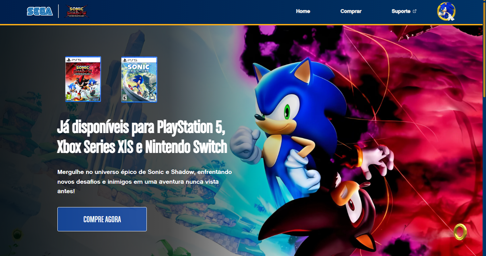
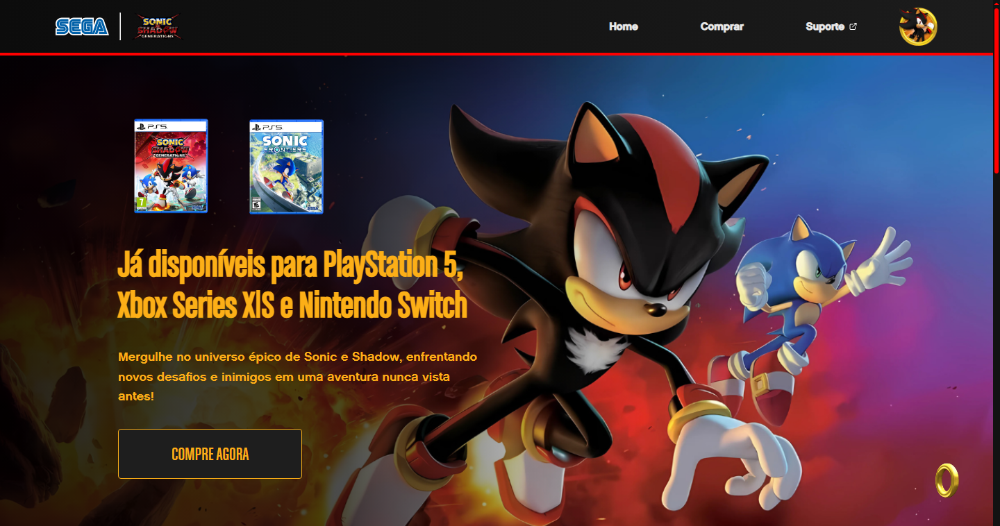
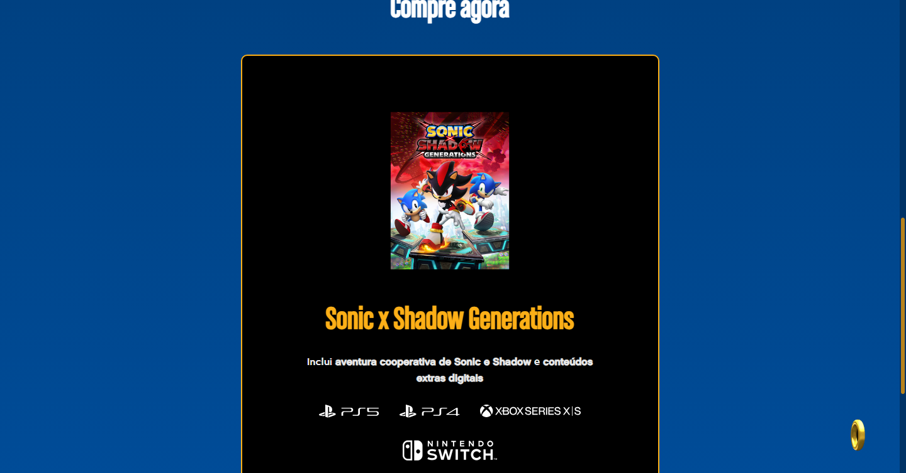
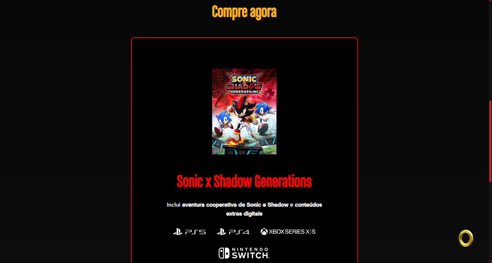
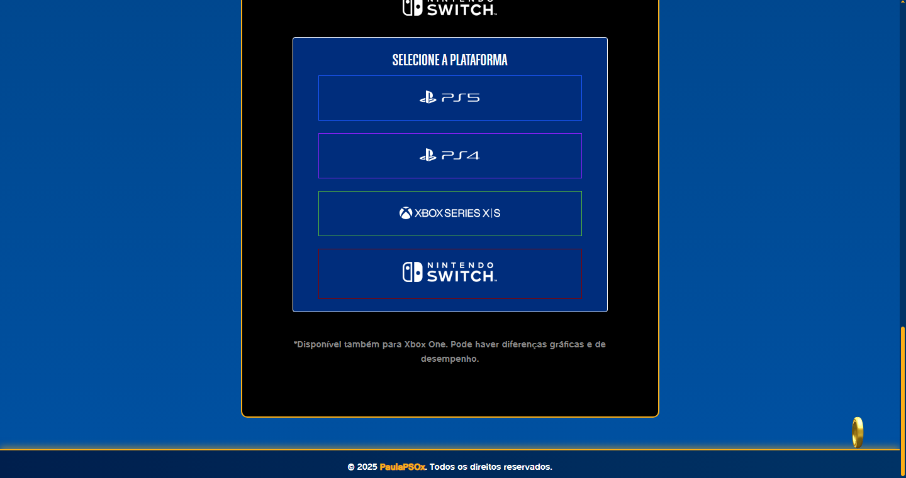
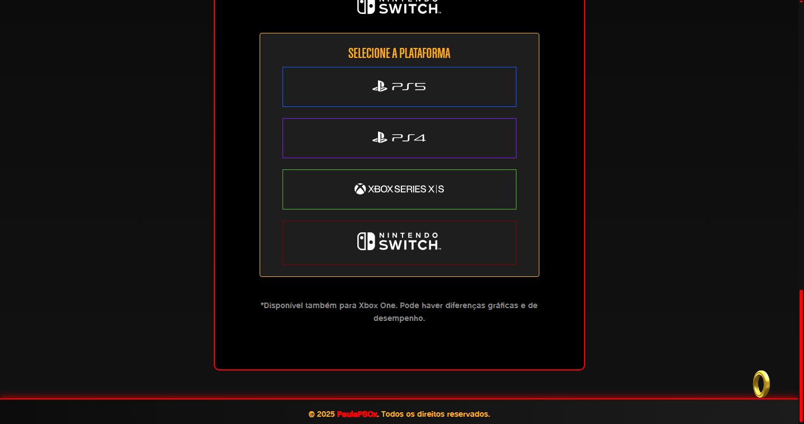

<div align="center">



<br><br>

# ⚡🦔💙 SONIC X SHADOW GENERATIONS

**Uma página de lançamento com dois temas, um carrossel veloz e um anel que toca som.**<br>
HTML5 · CSS3 · JavaScript puro — sem frameworks, sem build.

<p>
  
  
  
</p>

<p>
  <a href="https://paulapsox.github.io/sonic-x-shadow-generations/">
    
  </a>
  <a href="https://github.com/paulaPSOx/sonic-x-shadow-generations">
    
  </a>
</p>

</div>

---

## ⚡ Em 30 segundos

| | |
| :-- | :-- |
| **O que é** | Página de apresentação do jogo Sonic x Shadow Generations: fundo em carrossel, tema Sonic ou Shadow, seção "Compre agora" com links para as lojas e um anel clicável com som. |
| **Para quê** | Praticar uma landing page responsiva, variáveis CSS para temas, `localStorage`, carrossel automático e áudio. |
| **Destaque** | O tema troca o `data-theme` do `<html>`, e o CSS muda todas as cores por variáveis. A escolha fica salva no navegador. |
| **Stack** | HTML5, CSS3 e JavaScript puro. |
| **Online** | [paulapsox.github.io/sonic-x-shadow-generations](https://paulapsox.github.io/sonic-x-shadow-generations/) |

---

## 🔵🔴 Os dois temas: as telas

Cada linha mostra a mesma parte da página no tema **Sonic** (esquerda) e no tema **Shadow** (direita).

<table>
  <tr>
    <td width="50%" valign="top">
      <a href="https://paulapsox.github.io/sonic-x-shadow-generations/">
        
      </a>
      <p align="center"><strong>1 · Home · Sonic</strong><br>Cabeçalho azul e botão amarelo.</p>
    </td>
    <td width="50%" valign="top">
      <a href="https://paulapsox.github.io/sonic-x-shadow-generations/">
        
      </a>
      <p align="center"><strong>2 · Home · Shadow</strong><br>Cabeçalho preto, borda vermelha.</p>
    </td>
  </tr>
  <tr>
    <td width="50%" valign="top">
      <a href="https://paulapsox.github.io/sonic-x-shadow-generations/#comprar">
        
      </a>
      <p align="center"><strong>3 · Compre agora · Sonic</strong><br>Capa, descrição e plataformas.</p>
    </td>
    <td width="50%" valign="top">
      <a href="https://paulapsox.github.io/sonic-x-shadow-generations/#comprar">
        
      </a>
      <p align="center"><strong>4 · Compre agora · Shadow</strong><br>Mesma seção com as cores do Shadow.</p>
    </td>
  </tr>
  <tr>
    <td width="50%" valign="top">
      <a href="https://paulapsox.github.io/sonic-x-shadow-generations/#comprar">
        
      </a>
      <p align="center"><strong>5 · Plataformas · Sonic</strong><br>Lista aberta com links para as lojas.</p>
    </td>
    <td width="50%" valign="top">
      <a href="https://paulapsox.github.io/sonic-x-shadow-generations/#comprar">
        
      </a>
      <p align="center"><strong>6 · Plataformas · Shadow</strong><br>A mesma lista no tema escuro.</p>
    </td>
  </tr>
</table>

> 💡 **Dica para quem for testar:** clique no ícone do Sonic (ou do Shadow) no canto direito do cabeçalho para trocar o tema. Depois clique em **Selecione a plataforma** e no anel dourado que flutua no canto da tela.

---

## ⭐ Anéis coletados: funcionalidades

- Cabeçalho com os logos da SEGA e do jogo e o menu **Home**, **Comprar** e **Suporte** (abre o suporte da SEGA em outra aba).
- Fundo da home em carrossel automático, com 5 imagens e troca a cada 5 segundos.
- Botão de tema no cabeçalho alterna entre as cores do Sonic (azul e amarelo) e do Shadow (preto, vermelho e amarelo). A escolha fica salva no navegador.
- Seção **Compre agora**: capa do jogo, descrição, logos das plataformas e o botão **Selecione a plataforma**, que abre uma lista com links de busca nas lojas da PlayStation, do Xbox e da Nintendo.
- Anel do Sonic flutuante: ao clicar, toca um som e três anéis aparecem por meio segundo.
- Layout adaptado a telas menores com media queries.

> **Observação:** não há backend nem compra de verdade. Os botões levam à busca nas lojas oficiais, e o tema só é salvo no navegador.

---

## 🔧 Por dentro do código

Algumas decisões que tomei durante o desenvolvimento:

| Tema | Como foi resolvido |
| :-- | :-- |
| **Temas com variáveis CSS** | `:root` define `--cor-primaria`, `--cor-secundaria`, `--cor-fundo` e `--cor-texto`. O bloco `[data-theme="shadow"]` redefine as quatro, e o resto do CSS só usa `var(...)`. |
| **Tema salvo** | O JavaScript lê `localStorage.getItem('theme') || 'sonic'` ao carregar, aplica o `data-theme` no `<html>` e grava a nova escolha a cada clique. |
| **Carrossel** | Um array `imagens` com 5 caminhos, o índice `indiceImagemAtual` e `% imagens.length` para voltar ao começo. `setInterval(alternarImagem, 5000)` troca o `src` da imagem de fundo. |
| **Lista de plataformas** | O clique em `.btn-plataforma` faz `classList.toggle("ativo")` na lista. No CSS, a lista começa em `display: none` e a classe `ativo` a mostra. |
| **Anel do Sonic** | O clique mostra `#ring`, volta o áudio ao início (`currentTime = 0`), toca o som e usa `setTimeout` de 500 ms para esconder os anéis. |
| **Fontes** | Chalet vem da CDN `fonts.cdnfonts.com`; `ChaletComprime.ttf` é local, carregada com `@font-face` e usada em títulos. |
| **Responsividade** | `responsividade.css` com breakpoints em 1024 px, 668 px e 325 px. |

### 🎯 Destaque: o sistema de temas

| Variável ou função | Papel no projeto |
| :-- | :-- |
| `data-theme` | Atributo no `<html>` (`sonic` ou `shadow`) que ativa as variáveis de cada tema. |
| `savedTheme` | Tema lido do `localStorage` ao abrir a página (padrão: `sonic`). |
| `applyTheme(theme)` | Troca o ícone do botão e o `alt` conforme o tema. |
| `toggleThemeButton` | Botão que alterna entre `sonic` e `shadow` e grava a escolha. |
| `imagens` e `indiceImagemAtual` | Lista do carrossel e posição atual. |
| `alternarImagem()` | Mostra a próxima imagem e avança o índice. |

---

## 🧬 Equipe Sega: tecnologias

<table>
  <tr>
    <td align="center" width="33%">
      <br>
      <strong>HTML5</strong><br>
      <sub>Cabeçalho, menu, seções, áudio e <code>lang="pt-BR"</code>.</sub>
    </td>
    <td align="center" width="33%">
      <br>
      <strong>CSS3</strong><br>
      <sub>Variáveis, temas, animações e media queries.</sub>
    </td>
    <td align="center" width="33%">
      <br>
      <strong>JavaScript</strong><br>
      <sub>Eventos, <code>localStorage</code>, carrossel e áudio.</sub>
    </td>
  </tr>
</table>

**Complementos:** fonte Chalet (CDN e arquivo local), logos e ícones em SVG, GIF do anel e hospedagem no GitHub Pages.

---

## 🗂️ Estrutura do projeto

```text
sonic-x-shadow-generations/
├── index.html                # Página única
├── imagens-projeto/          # Prints usados neste README
├── src/
│   ├── css/                  # style.css (principal) e responsividade.css
│   ├── fontes/               # ChaletComprime.ttf
│   ├── imagens/
│   │   ├── icone/            # Logos, ícones das plataformas e GIF do anel
│   │   ├── jogo/             # Capas e logos dos jogos
│   │   ├── sounds/           # sonic-ring-sound.mp3
│   │   └── wallpaper/        # 5 imagens de fundo do carrossel
│   └── js/                   # index.js
├── LICENSE
└── README.md
```

---

## 🚀 Como rodar

Não há dependências nem etapa de build. Escolha uma das opções:

**Opção 1 — Acessar online:** [abrir no GitHub Pages](https://paulapsox.github.io/sonic-x-shadow-generations/).

**Opção 2 — Baixar o ZIP:** clique em **Code → Download ZIP** neste repositório, extraia e abra o `index.html` no navegador.

**Opção 3 — Clonar com Git:**

```bash
git clone https://github.com/paulaPSOx/sonic-x-shadow-generations.git
cd sonic-x-shadow-generations
```

Depois, abra o `index.html` no navegador. Se usar o VS Code, a extensão **Live Server** também funciona.

> A fonte Chalet (CDN) precisa de internet. As imagens de fundo são pesadas (somam cerca de 6,7 MB), então a primeira carga pode demorar.

---

## 📚 O que este projeto me ensinou

- Criar temas com variáveis CSS e um atributo `data-theme`.
- Salvar uma preferência com `localStorage` e lê-la ao abrir a página.
- Montar um carrossel automático com `setInterval` e índice circular.
- Tocar um som e disparar um efeito visual com `setTimeout`.

---

## 🏁 Próximas fases

Melhorias que quero fazer, e que **ainda não estão implementadas**:

- [ ] Corrigir o `src` inicial da imagem de fundo no HTML (hoje aponta para um arquivo que não existe).
- [ ] Fazer o tema e o carrossel funcionarem juntos: hoje o carrossel troca o fundo a cada 5 s e sobrescreve o fundo do tema.
- [ ] Proteger `localStorage` e `play()` com `try/catch`.
- [ ] Trocar a `div` do seletor de plataformas por um `button` com `aria-expanded`, e permitir pausar o carrossel.
- [ ] Reduzir o peso dos wallpapers e do logo SVG, e carregar imagens só quando necessário.

---

## 🎨 Inspiração e créditos

Projeto inspirado nos desafios criativos da comunidade **[Dev Em Dobro](https://github.com/devemdobro)** e da **Guild Dev Em Dobro**, e na estética dos jogos da série Sonic Generations. Obrigada por inspirarem projetos que unem aprendizado, criatividade e paixão por games.

---

## 📄 Licença e aviso

Código disponibilizado sob a licença **MIT**. Veja o arquivo [`LICENSE`](LICENSE). A licença vale para o código, não para imagens, logos, sons e fontes de terceiros.

Projeto independente, feito para estudo e portfólio. Não possui vínculo, patrocínio ou aprovação da SEGA, da Sonic Team, da Sony, da Microsoft, da Nintendo ou de qualquer outra detentora de direitos. Sonic, Shadow, nomes, logos, imagens, capas e sons pertencem aos seus respectivos titulares.

---

<div align="center">

## 👩‍💻 Feito por Paula Oliveira

Desenvolvedora full stack em formação, com foco atual em front-end.<br>
Este projeto marca minha prática com temas em CSS, `localStorage` e interações com áudio.

<p>
  <a href="https://github.com/paulaPSOx">
    
  </a>
  <a href="https://www.linkedin.com/in/oliveiraspaula/">
    
  </a>
</p>

**Gostou? Deixe uma ⭐ no repositório.** ⚡🦔💙

</div>
